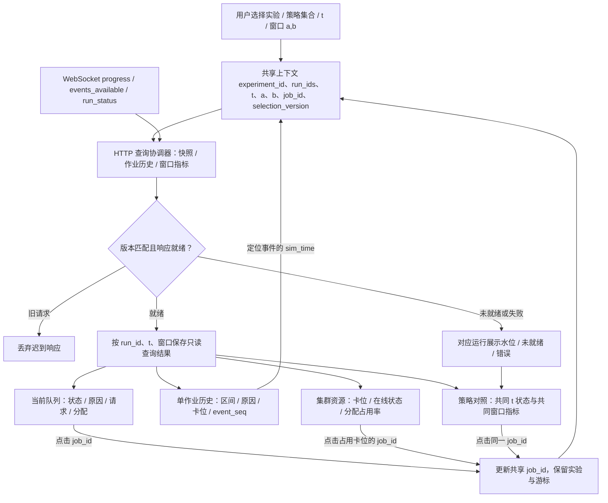

# 控制台视图交互图

覆盖 FR-JOB-04～05、FR-OBS-01、FR-OBS-03、FR-OBS-04、FR-EXP-04、NFR-EXP-02。页面不计算调度或指标；四视图只消费相同上下文的响应。改变 t 不自动改变窗口 [a,b)，修改窗口不自动推进 t；切换实验清除旧作业选择、缓存与订阅。同一 job_id 在各策略下分别查询，尚未到达的作业不进入当前队列。筛选与排序仅作用于显示，不修改仿真输入。逐事件定位用 event_seq 选中记录，四视图仍呈现该记录时刻处理至固定点后的状态，不发布同刻中间态。

**EXP-A 走查**：t=2 点击可行即运行列的 J3，在历史中看到开始时刻 2 和分配卡位；FIFO 同标识显示排队及阻塞项 J2，不能沿用另一策略的分配。t=8、窗口 [0,8) 时，两列完成数为 1/2，未完成数为 2/1，分配 GPU·秒为 10/13，占用率为 62.5%/81.25%。首版实际利用率均显示「无数据」，不绘制 0% 曲线。

状态名称与黄帅的作业状态机核对为「未到达、排队、运行、完成」，等待原因沿用四类定义；未就绪、异常中止属于运行查询状态，不新增作业状态。单位与龚旭现有 EXP-A 及规格 4.6 核对：秒、GPU·秒、作业/秒，比例接口用 0～1，界面转百分比；finish_time=b 在 t=b 已完成但不计入 [a,b) 完成数。以上为文档对照，未代替两位负责人的本人评审。

与文字对齐：概要设计 7.2 定义共享上下文、单位和查询状态；P0 不引入 P1 传感器、多尝试或缺失轨迹功能。
