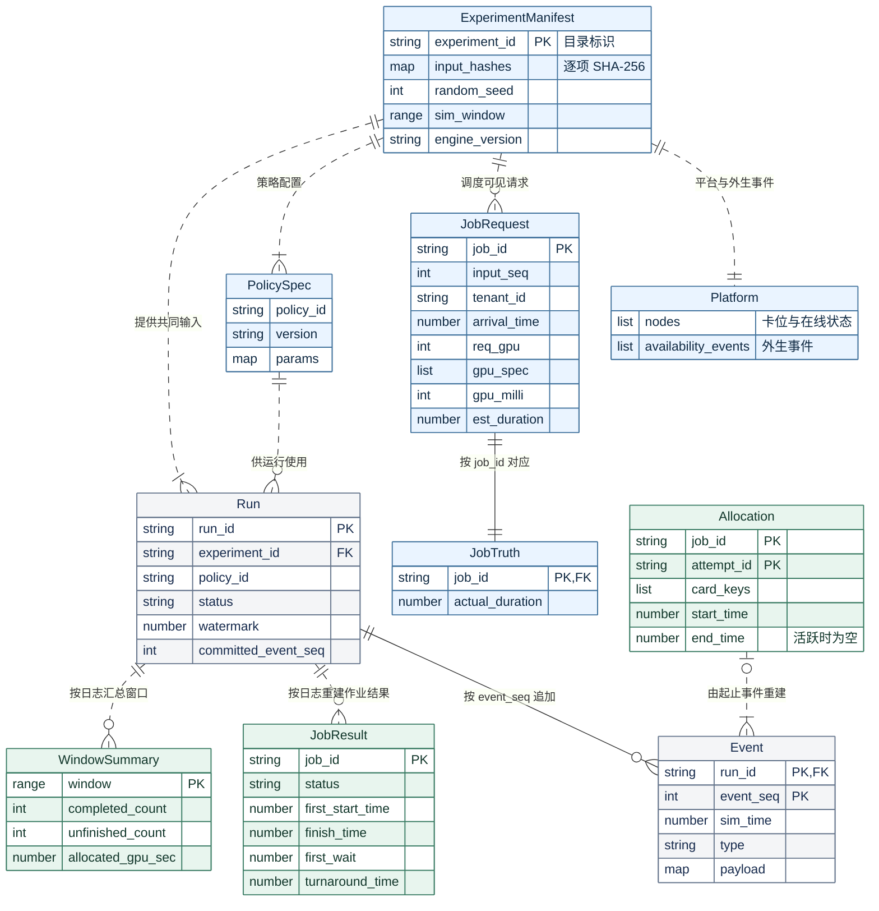

# 实验数据实体关系图

**覆盖需求** FR-EXP-01～04、NFR-EXP-01～02，对应概要设计第 6、8 节。

| 图中对象 | 文件与约束 |
| --- | --- |
| 蓝色 · 冻结输入 | 清单位于 `manifest.json`，图中的 `job_id` 在一份负载内唯一。`platform.json` 保存平台和外生节点上下线事件，`workload.json` 保存 `JobRequest`，`truth.json` 保存 `JobTruth`。平台、外生事件、负载、策略配置、种子、仿真窗口和引擎版本都进入输入哈希，负载的两个文件均纳入校验。仿真推进时由 M3 使用真值安排完成事件，M4 从不含真值的 `SchedulerView` 读取调度信息。 |
| 灰色 · 运行记录 | 一个 `Run` 绑定清单中的一个 `PolicySpec` 条目，含标识、版本与参数。各运行独立写入 `runs/<run_id>/events.jsonl`。事件键为 `(run_id, event_seq)`，水位与提交序号一起发布。 |
| 绿色 · 派生结果 | 在一次运行内，`Allocation` 按 `(job_id, attempt_id)` 从一个开始事件和至多一个完成事件重建，卡型按 `(node_id, gpu_id)` 查回平台配置。M8 用调度请求、平台和已提交事件生成指定窗口的逐作业结果和汇总，分别导出为 `jobs.csv` 和 `summary.json`。窗口汇总按实际分配卡型计算分配量、占用率和 Jain 指数。结果与可重建的 `checkpoints/` 均在输入哈希之外。 |

**EXP-A 走查（AC-EXP-03）**。稳定 FIFO 的 `J1` 在 `[0,6)` 占用 1 张卡，`J2` 自 `t=6` 起占用 2 张卡。M8 截取 `[0,8)` 得到 `6×1 + 2×2 = 10 GPU·秒`，配置总容量为 `2×8 = 16 GPU·秒`，分配占用率为 62.5%。完成 1 项，已完成作业首次等待和周转均值分别为 0、6 秒。未完成 2 项，`J2` 已运行至少 2 秒且首次等待为 5 秒，`J3` 已等待至少 6 秒。`J2` 仍在运行，分配占用量截取至窗口右端。

**与概要设计对齐**。第 6.3 节明确清单与引用文件组成可移交的实验输入，第 8 节明确哈希边界以及窗口末端统计的取值时点。
