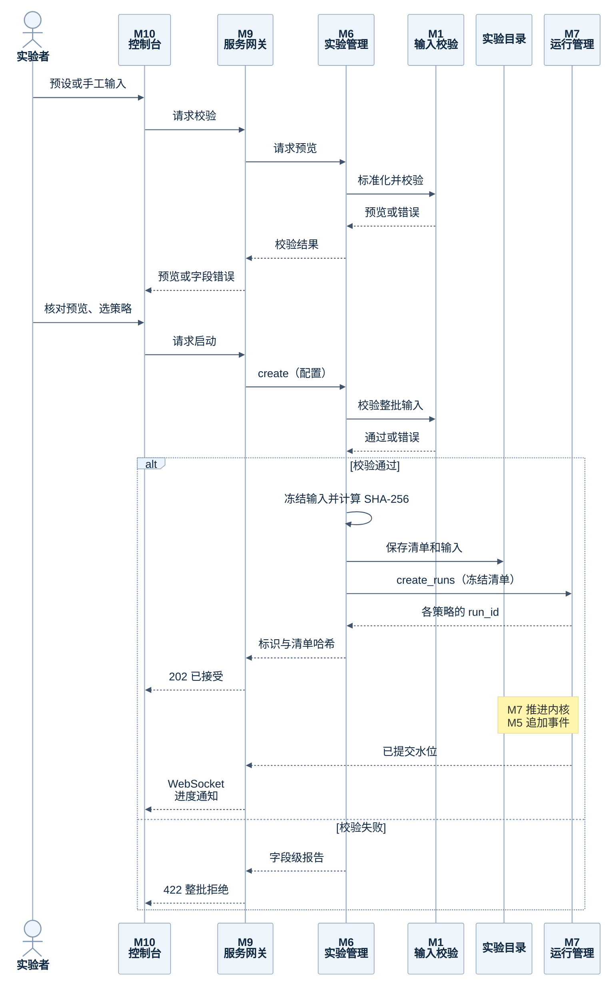
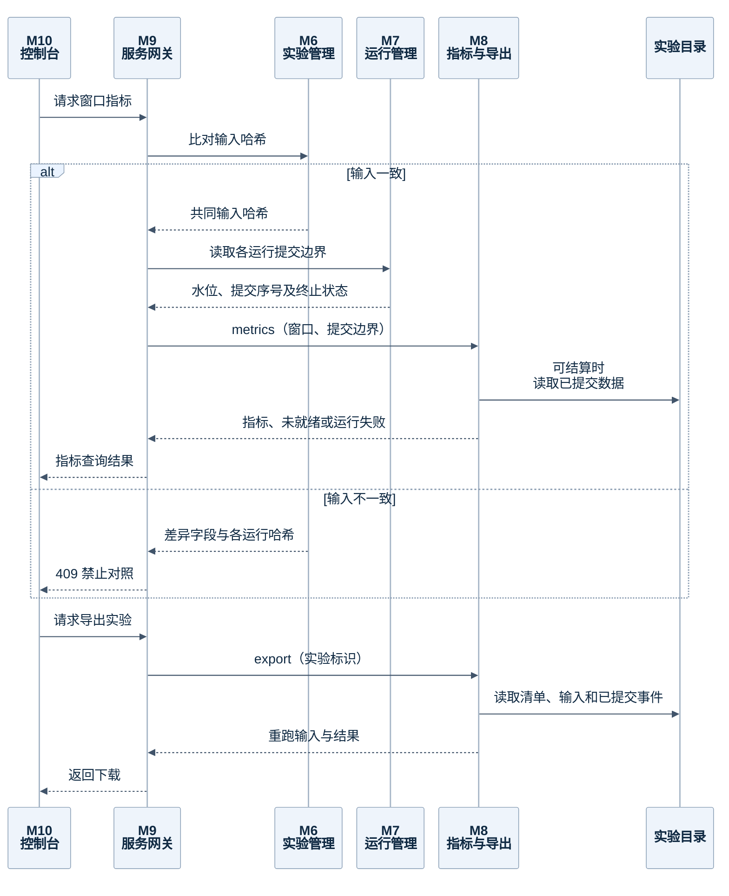
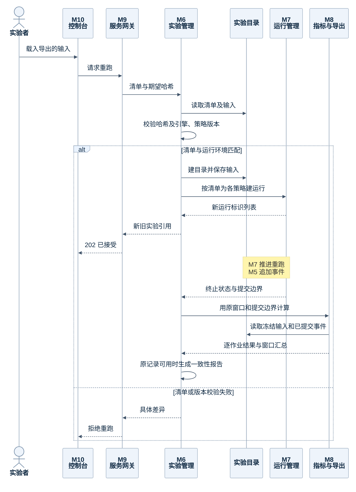

# 实验启动与重跑时序图

## 载入与启动

场景校验使用 `POST /api/scenarios/validate`，确认启动使用 `POST /api/experiments`。

## 同源对照与导出

查询使用 `GET /api/experiments/{id}/metrics?a=&b=`，导出使用 `GET /api/experiments/{id}/export`。

## 凭清单重跑

重跑使用 `POST /api/experiments/rerun`。缺少关键配置返回 422，哈希不符或指定的引擎、策略版本不可用返回 409，均附具体差异。

**覆盖需求** UC-06～08、FR-EXP-01～04、NFR-EXP-01，对应概要设计 5.1、5.4 和 7.2 节。

- 创建与重跑使用 `Idempotency-Key`。启动校验失败时整批拒绝。M6 比较参与对照的运行，只放开 `policy_spec` 的差异。错误响应的 `details` 给出字段路径、运行标识及相应哈希。同源通过后，M8 按 M7 发布的水位与提交序号结算；正常完成可将已知终态延伸至 `b`。
- 导出包含清单和全部引用输入，以及 `jobs.csv` 和 `summary.json`。带着清单及其输入文件即可重跑。只导入输入时可以生成新运行，有随导出保留的原结果时可以同时核对起止时刻、卡位和窗口指标。有原事件记录时可按 `event_seq` 做逐事件核对。

**EXP-A 走查（AC-EXP-01、02）**。AC-EXP-01 用 `seed=42` 和稳定 FIFO 生成一份单策略清单。按原清单重跑后，清单哈希、已知作业起止时刻、卡位、完成数 1、未完成数 2、分配量 10 GPU·秒应一致。改动 `truth.json` 中的时长后，M6 定位对应输入并拒绝创建运行。AC-EXP-02 另建双策略实验，两次运行使用相同平台、负载与种子。窗口 `[0,8)` 内，稳定 FIFO 与可行即运行的吞吐分别为 0.125、0.25 作业/秒，占用率为 62.5%、81.25%，Jain 指数为 `25/26`、`169/170`。错配样例将其中一份运行的 `random_seed` 改为不同值，M6 返回该字段的差异。

**与概要设计对齐**。第 5.4、6.3 节补充清单引用文件的重跑条件，第 7.2 节补充同源失败和导出内容。
