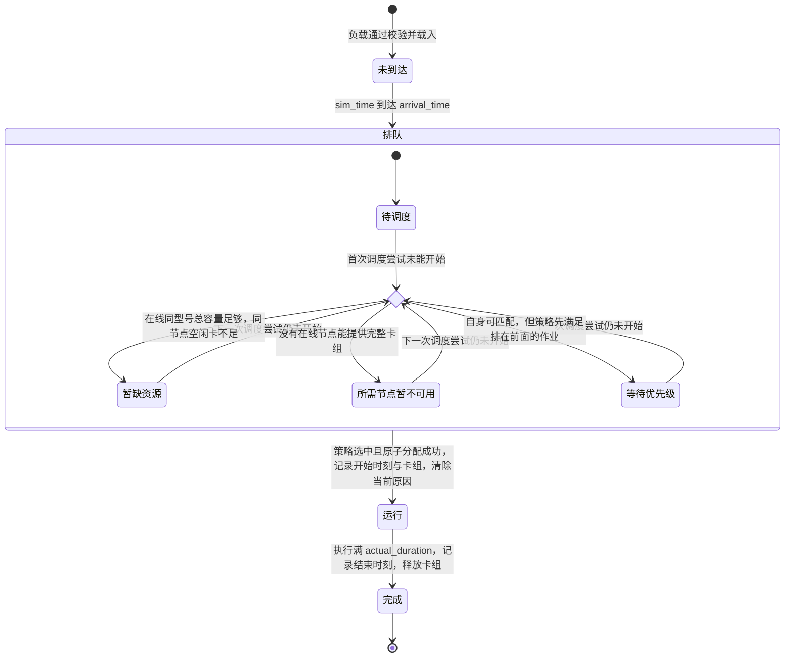

# 作业状态机图

## 说明

**覆盖需求**：FR-JOB-04、FR-JOB-05、FR-RES-02；规格说明书 4.2。

**关键约束**

- 校验失败的负载不进入状态机：整批拒绝，没有作业被载入。
- 到达与开始可以在同一仿真时刻发生：作业先进入「待调度」，在同刻调度轮次中直接转为运行。
- 「排队」内的四个子状态就是当前等待原因。每次调度尝试后按判定条件更新，并记录原因、仿真时刻和依据；原因历史保留，用于回放。
- 观察窗口结束时，排队或运行中的作业保留当时状态，并带上「窗口内未完成」标记。这是统计标记，不是状态，所以不画成状态转换。
- 取消、故障和超时随对应功能评审，首版状态机没有这些转换。

**原因判定规则（待马浩博确认）**

| 作业位置 | 自身当前能否匹配 | 显示原因 |
| --- | --- | --- |
| 尚未经过调度尝试 | — | 待调度 |
| FIFO 队首 | 否 | 按匹配器分类：暂缺资源或所需节点暂不可用 |
| FIFO 非队首 | 是 | 等待优先级 |
| FIFO 非队首 | 否 | 按匹配器分类：暂缺资源或所需节点暂不可用 |
| 可行即运行中被跳过 | 否 | 按匹配器分类：暂缺资源或所需节点暂不可用 |

规则依据：「等待优先级」只用于资源允许、但调度顺序阻止它运行的情况；作业自身就无法匹配时，显示资源原因更能说明它在等什么。因此 FIFO 下非队首作业也要经过匹配器分类，调度轮次需要为每个排队作业取得匹配结果。

**状态与原因命名对照（待杜志鸣确认界面用语）**

| 界面名称 | 代码标识 | 类别 |
| --- | --- | --- |
| 未到达 | `not_arrived` | 状态 |
| 排队 | `queued` | 状态 |
| 运行 | `running` | 状态 |
| 完成 | `completed` | 状态 |
| 待调度 | `pending_schedule` | 等待原因 |
| 暂缺资源 | `resources` | 等待原因 |
| 所需节点暂不可用 | `node_unavailable` | 等待原因 |
| 等待优先级 | `priority` | 等待原因 |

## 样例走查

| 样例 | 路径 |
| --- | --- |
| AC-JOB-02（1 张 GPU，A 运行 [0,180)，B 于 60 秒到达） | B：未到达 → 排队/待调度 → 排队/暂缺资源（队首，唯一卡被 A 占用）→ 180 秒 A 完成释放后转为运行，原因清除 |
| AC-JOB-05（唯一 H100 节点起初离线，240 秒恢复） | 作业：未到达 → 排队/待调度 → 排队/所需节点暂不可用 → 240 秒节点恢复后转为运行 |
| AC-JOB-06（2 张卡占用 1 张，A 在队首请求 2 张，B 请求 1 张） | A：排队/暂缺资源；B：自身可匹配但 FIFO 不越过 A，排队/等待优先级 |
| SCH-A 稳定 FIFO，t=3 | L 队首请求 2 张、仅 1 张空闲 → 暂缺资源；S、T 各请求 1 张，自身可匹配 → 等待优先级 |
| RES-A，V 在 2、5、8 秒 | 2 秒排队/暂缺资源（集群空闲 2 张 A100 但不在同一节点）→ 5 秒运行 → 8 秒完成 |

## 与概要设计的差异

- 概要设计 5.2 第 4 步只写了「更新各作业原因」，没有说明 FIFO 下非队首作业也要经过匹配器分类。已在 5.2 补充。
