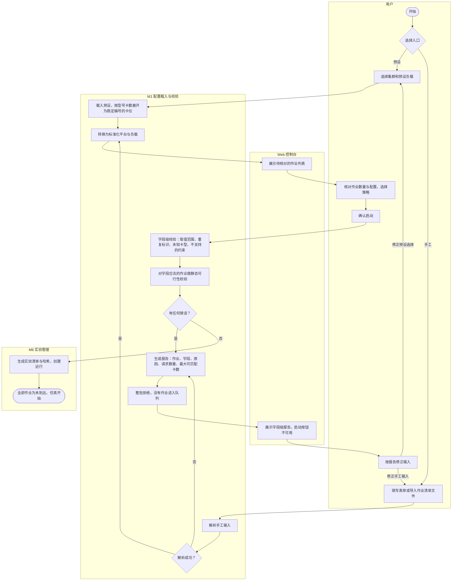

# 负载载入与校验活动图

## 说明

**覆盖需求**：FR-JOB-01、FR-JOB-02、FR-JOB-03、FR-RES-01；规格说明书 4.1。

**关键约束**

- 两条入口在「转换为标准化平台与负载」处合流，之后的核对、校验和启动完全相同。这是 AC-JOB-07 两种入口结果一致的前提。
- 校验一次收集全部错误再报告，不在第一个错误处停止，用户可以一次改完。静态可行性只对字段合法的作业执行，因为字段非法时无法判断可行性。
- 静态可行性校验忽略作业之间的占用和队列顺序，只看场景配置及其上下线事件中是否存在过同节点、同型号、数量足够的卡组。
- 手工文件解析失败（格式错误、缺列）也进入同一份报告，定位到文件中的行或字段。

## 样例走查

| 样例 | 路径与结果 |
| --- | --- |
| AC-JOB-03（A 合法，B 的 GPU 数量为负） | 字段级校验报 B 的 `req_gpu`；A 通过静态校验；有错误 → 整批拒绝，两项作业都不进队列 |
| AC-JOB-04（只有 A100，作业请求 H100） | 字段级校验报未知卡型 `H100` → 整批拒绝 |
| AC-RES-03（RES-A 下请求 3 张 A100） | 字段合法；静态校验报同节点同型号最多 2 张，最大可匹配卡数 2 → 整批拒绝 |
| AC-RES-04（`n01` 起初离线，4 秒恢复） | 恢复事件使 `n01` 存在可行卡组 → 通过；删除恢复事件后静态校验失败 |
| AC-JOB-07（同一负载分别从两种入口载入） | 两条路径产出相同的标准化输入，后续运行结果一致 |

## 与概要设计的差异

- 概要设计 5.1 第 1 步「用户提交平台、负载和所选策略」缺少载入、展开卡位和启动前核对。已在 5.1 补充。
- 解析失败是否计入同一份字段级报告，规格说明书没有明确。本图按计入处理，待评审确认。
