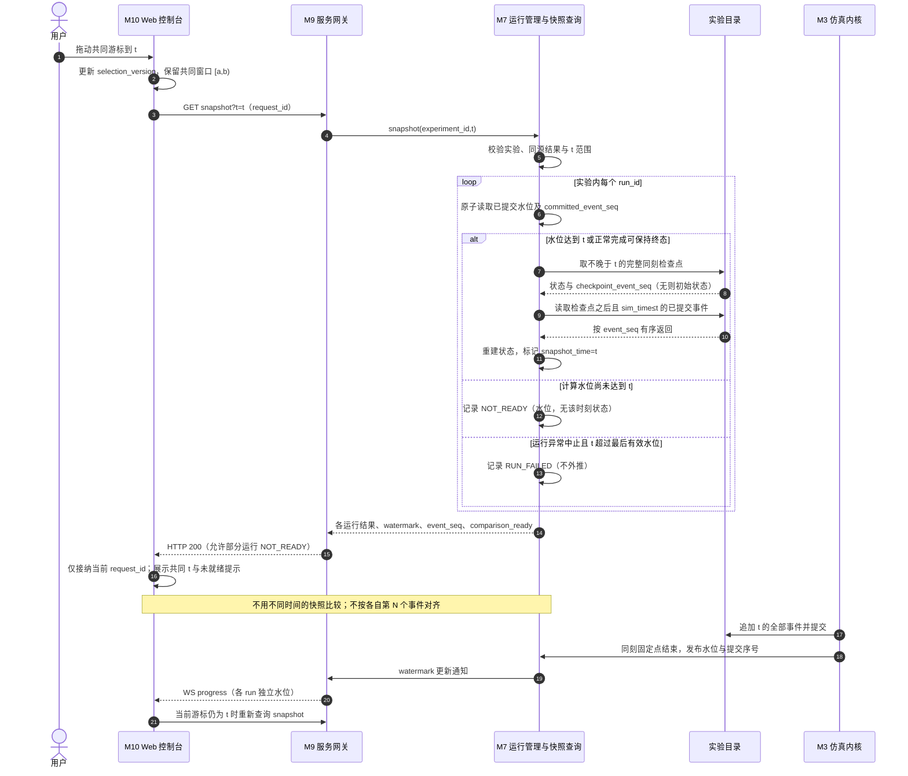

# 同时钟快照查询时序图

覆盖 FR-OBS-01、FR-OBS-04、FR-JOB-04、NFR-EXP-02。检查点只在完整同刻处理后生成；若事件数达到保存间隔，也必须等同刻固定点结束。水位与提交序号成对读取，不读取内核正在修改的对象；查询不驱动调度。水位可在确认下一事件晚于目标时推进至该目标，无须伪造业务事件。正常完成可展示终态到实验窗口末尾，并附实际结束时间；异常中止不能如此处理。

**AC-OBS-05 走查**：A 水位 100 秒、B 水位 80 秒，定位 t=90。A 返回 90 秒状态，B 返回 NOT_READY 和水位 80，comparison_ready=false；B 水位达到 90 后重新查询，两列 snapshot_time 都为 90，才允许解释同时刻差异。快速拖到 95 后，迟到的 90 秒响应按 request_id 丢弃。

**EXP-A 走查**：t=2 固定点后，稳定 FIFO 的 J3 排队且原因「等待优先级」（阻塞项 J2）；可行即运行的 J3 在第二张 A100 运行。t=8 两侧 J2 均运行，FIFO 的 J3 仍排队，可行即运行的 J3 已完成。共同窗口 [0,8) 的数值由 M8 提供，见概要设计 7.2；窗口与状态游标分别传递。

与文字对齐：第 5.3 节补充无事件时刻、水位发布、终态和检查点边界，第 7.2 节明确部分就绪响应，不要求把所有运行锁步计算。多尝试历史回放属于 P1。
