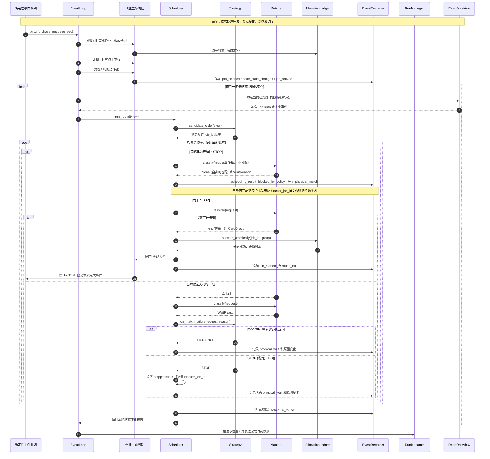

# 同刻处理与调度轮次时序图

需求覆盖 `FR-SCH-01`、`FR-SCH-05`、`NFR-SCH-01`～`NFR-SCH-03`。事件入队使用 `(sim_time, phase, enqueue_seq)`；事件追加时另分配单调递增的 `event_seq`。轮次以每个运行内唯一且递增的 `round_id` 标识，不另存重复轮次号。`schedule_round` 区分物理匹配结果和调度结果：FIFO 返回 `STOP` 后，后续项仍只读检查物理可匹配性，但不获分配机会。自身可匹配时记录「等待优先级」和阻塞它的作业标识；自身不可匹配时保留资源原因。`reason_changed` 和 `job_started` 可记录来源 `round_id`，各自通过 `event_seq` 定位。原因依据只含稳定字段，不含时刻和 `round_id`。终止轮也写入。策略视图不含真值和未来事件；物理状态由独立事件重建。

手算核对 `SCH-A`。t=2 时 R 占一卡，L 已在 t=1 到达且需两卡，S 于 t=2 到达。FIFO 因 L 不可匹配而停止，S 自身可匹配，所以记录「等待优先级」，依据为 L 的 `job_id`；S 不启动。可行即运行检查 S 并使其于 `[2,4)` 运行。t=10 时先处理 R 完成并释放一卡。FIFO 为 L 分配两卡，S 与 T 的物理匹配分类均为「暂缺资源」，两者均不启动。可行即运行中 T 已于 t=4 启动并占用一卡，L 在 t=10 仍暂缺一卡，待 T 于 t=16 完成后再启动，区间为 `[16,26)`。队首保护回填是 P1 候选，不属于首版策略接口。
