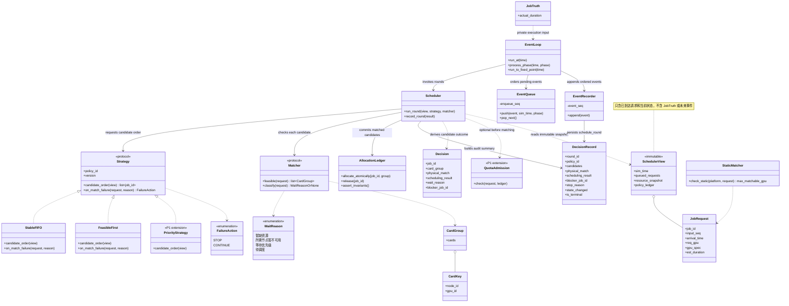

# 调度内核类图

需求覆盖 `FR-SCH-01`、`FR-SCH-05`、`FR-SCH-07`、`FR-RES-01` 和 `NFR-SCH-03`。M1 字段校验后调用 M2 的 `check_static`，按 `gpu_spec` 和后续节点状态变更计算最大可匹配卡数。`CardKey` 为 `(node_id, gpu_id)`，`CardGroup` 是同一节点、同一型号的有序卡位组。M2 的 `classify` 在当前资源快照中存在可行组时返回 `None`，否则返回资源原因。策略只提供候选顺序和失败动作。内核每分配一项就更新账本，再检查下一项。

FIFO 遇到不能匹配的队首时返回 `STOP`，停止启动后续候选。内核仍对后项做只读物理匹配判定：自身可匹配则标记策略阻塞和「等待优先级」，附 `blocker_job_id`；自身不可匹配则标记物理不匹配并保留资源原因。P1 配额准入与物理匹配分开记录，优先级策略作为候选排序扩展点。真值时长只供内核安排完成事件，调度视图不含真值或未来事件。

手算核对 `SCH-A`。t=2 时 FIFO 对 L 匹配失败并停止，S 自身可匹配，记录「等待优先级」且 `blocker_job_id=L`，不启动；可行即运行检查并启动 S 于 `[2,4)`。t=10 时 R 完成释放后，FIFO 为 L 分配两卡，S 和 T 均因当前空闲卡不足而标记「暂缺资源」。可行即运行中 T 已占一卡，L 仍暂缺一卡，直到 T 于 t=16 完成后 L 才启动。
