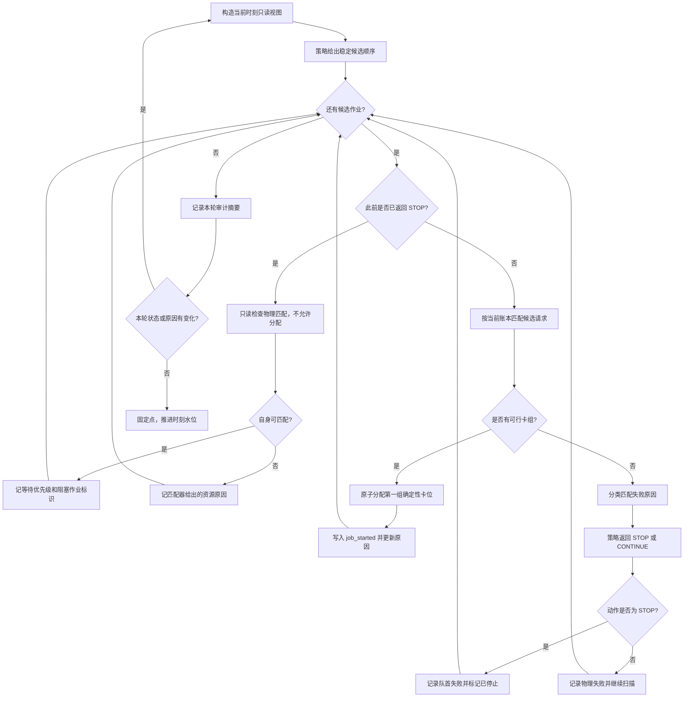

# 调度轮次活动图

需求覆盖 `FR-SCH-01`、`FR-SCH-05`、`FR-SCH-07`、`IS-04` 和 `NFR-SCH-03`。稳定 FIFO 遇到队首匹配失败时停止为后项分配，但仍只读检查每项自身的物理匹配状态。自身可匹配的后项显示「等待优先级」，依据写明阻塞它的作业标识；自身不可匹配时按匹配器结果显示「暂缺资源」或「所需节点暂不可用」。可行即运行在失败项返回 `CONTINUE` 后继续逐项检查。匹配结果和调度结果分字段记录，原因只在原因值或稳定依据变化时更新，终止轮也写入 `schedule_round`。

手算核对 `SCH-A`。L 在 t=1 到达，S 在 t=2 到达。t=2 时 FIFO 遇到 L 暂缺资源后停止，继续只读匹配检查确认 S 自身可匹配，所以 S 因阻塞作业 L 等待，不启动；可行即运行启动 S 于 `[2,4)`。t=10 时先释放 R 的卡，FIFO 为 L 分配两卡，S 与 T 均因无空闲卡而暂缺资源。可行即运行下 T 已从 t=4 占一卡，L 仍暂缺一卡，待 T 于 t=16 完成后再启动，区间为 `[16,26)`。
