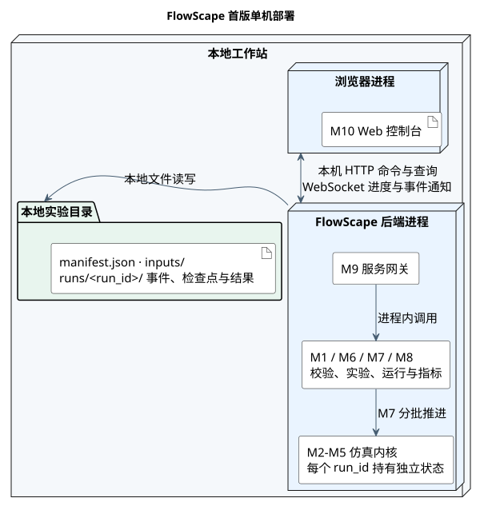

# 单机部署图

[PlantUML 源文件](single-host-deployment.puml)

**覆盖需求** UC-01、UC-06～08、FR-OBS-04、FR-EXP-01～04、NFR-EXP-01～02。部署拓扑对应概要设计 3.3、6.3 和第 10 节。

首版按本地单用户部署。Web 控制台经 HTTP 向本机网关发送命令和查询并接收响应，通过 WebSocket 接收进度和事件通知。后端通过进程内调用协调校验、实验、运行、指标和内核模块，并通过文件接口读写本地实验目录。每个策略运行各自持有内核状态与事件记录。建议 M7 在单进程内轮流分批推进各运行，在同刻提交边界让出服务循环。多人共享部署的拓扑随团队评审决定。

**EXP-A 走查**。浏览器通过 HTTP 发起包含两种策略的实验，M6 落盘一份共同清单和输入。M7 为稳定 FIFO 与可行即运行创建两个独立内核及运行目录。后端通知各运行的水位，浏览器查询 `t=8` 快照及 `[0,8)` 指标。待两个运行的水位都覆盖 8 秒，M8 从各自的日志计算出 10、13 GPU·秒，并通过原 HTTP 查询接口返回。

**与概要设计对齐**。第 10 节明确单机部署下的多策略推进建议。多人共享部署仍是待评审的选项。
