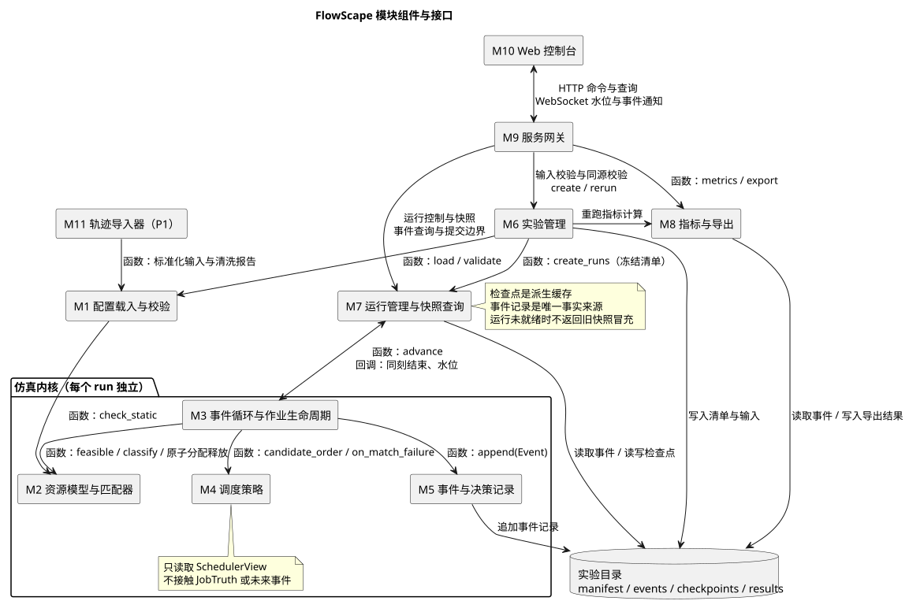

# 组件图说明

[PlantUML 源文件](system-components.puml)。覆盖 M1～M11 及 FR-JOB-01～05、FR-RES-01～02、FR-SCH-01/05/07、FR-OBS-01/03/04、FR-EXP-01～04。M11 为 P1，其余模块属于首版结构；浏览器与网关之间为 HTTP / WebSocket，同一后端进程内模块之间为函数调用，不引入额外消息队列。

箭头从调用/通知发送方指向接收方，标签同时说明接收方提供的接口。M3 通过 M5 追加事件，M7 只对已提交的事件重建快照，M8 复用事件计算指标；M9 不访问可变账本，不计算指标。M7 的推进命令与 M3 的水位回调是两个方向的控制交互，不能相互递归推进；推送速度不参与仿真结果。

M9 经 M6 完成输入预览、校验和同源校验。M7 提供运行控制、快照、单作业历史和全运行事件查询，并返回水位、提交序号和终止状态供 M8 结算。重跑结束后，M6 调用 M8 按原窗口和提交边界计算结果，再与原结果核对。

**EXP-A 走查**。M10 经 M9 提交三项作业，M6 调 M1 校验并冻结清单，M7 创建两个独立的 M3 实例。两种策略共享 M2 的分配规则和 M5 的记录规则。M7 按 t=2 重建快照。查询 [0,8) 时，M9 经 M6 核对同源、经 M7 取得提交边界，水位覆盖 8 秒后由 M8 计算 10、13 GPU·秒。RES-A 的静态不满足路径由 M1 调 M2 后返回字段级错误。

与文字对齐：第 4 节依赖说明补充 M8 读取事件和 M7 到 M3 的回调方向，第 7.2 节细化上述接口；部署仍为单机，不提前实现 P1 导入。
