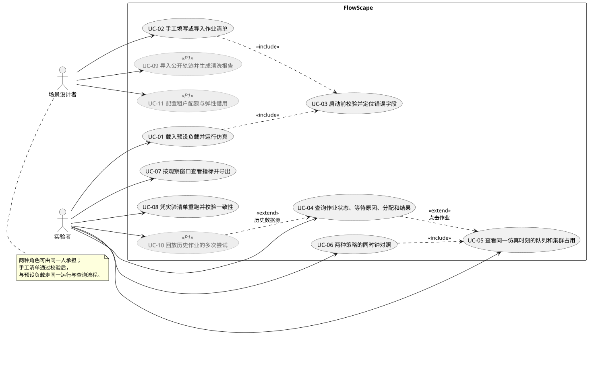

# 用例图

源文件：[use-case.puml](use-case.puml)

## 说明

**覆盖需求**：UC-01～UC-11，FR-JOB-01～05，以及 FR-OBS、FR-EXP 中的用户可见能力。灰色用例为 P1。

**关系**

| 关系 | 含义 |
| --- | --- |
| UC-01、UC-02 包含 UC-03 | 两条入口共用同一套校验，校验不通过不能启动（FR-JOB-03） |
| UC-06 包含 UC-05 | 同时钟对照建立在同一时刻的队列与资源快照之上（FR-OBS-04） |
| UC-04 扩展 UC-05 | 在队列或资源视图中点击作业，进入同一标识的历史（FR-OBS-01） |
| UC-10 扩展 UC-04 | 作业来自历史轨迹时，单作业查询增加多次尝试回放（FR-OBS-02，P1） |

**关键约束**

- 场景设计者的产出是一份手工清单。清单通过 UC-03 后，与预设负载使用相同的运行、查询和对照流程，图中不再为场景设计者重复画这些用例。
- UC-09 产出标准仿真输入，之后由实验者经 UC-01 载入。两者是数据上的先后关系，不是用例的包含关系，因此图中不连线。
- UC-08 的哈希与同源校验属于实验管理（M6），不复用 UC-03 的字段校验，因此不画包含关系。

## 样例走查（EXP-A）

1. 场景设计者经 UC-02 填写 J1、J2、J3 三项作业，UC-03 校验通过。
2. 实验者选择稳定 FIFO 与可行即运行，经 UC-06 在 t=8 对照两种策略的队列（UC-05）。
3. 点击 J2 经 UC-04 查看首次等待 5 秒与当前分配。
4. 经 UC-07 查看窗口 `[0, 8)` 的吞吐 0.125 与 0.25 作业/秒并导出，再经 UC-08 凭清单重跑，结果一致。

## 与概要设计的差异

无。
