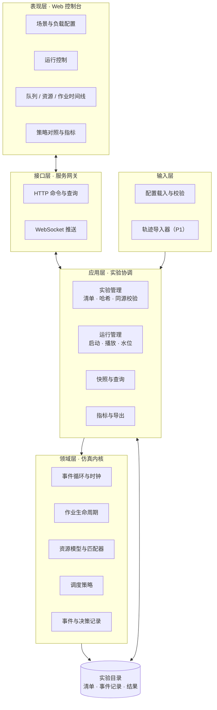

# FlowScape 概要设计说明书

| 项目 | 内容 |
| --- | --- |
| 版本 | v0.1 草案 |
| 需求基线 | [需求规格说明书](../需求分析/需求规格说明书.md) v0.1 的 P0 范围 |
| 状态 | 待团队评审；技术选型与 UML 图按 [分工.md](分工.md) 完成后定稿 |

本说明书给出 FlowScape 首版的技术选型、总体架构、模块划分、核心流程、数据与接口设计。依赖待评审需求的设计点标注「待定」，需求变化时同步修订。

## 1 设计目标与原则

| 原则 | 设计含义 | 对应需求 |
| --- | --- | --- |
| 仿真内核与界面解耦 | 内核是不依赖网络和界面的独立库，可在命令行无头运行，也可被服务端调用 | NFR-EXP-01 |
| 事件记录是唯一事实来源 | 内核只追加事件，快照、回放、指标和导出都从事件记录推导，视图与报表天然同口径 | FR-OBS-01、NFR-EXP-02 |
| 确定性 | 不读墙钟；不依赖无序集合的遍历顺序；输入事件按 `(sim_time, phase, enqueue_seq)` 固定处理，追加记录按 `event_seq` 唯一排序；平级按 `arrival_time`、`input_seq`、`job_id` | NFR-SCH-01 |
| 信息隔离 | 策略只能拿到不含真值时长的只读视图，在类型上无法读取 `actual_duration` | FR-EXP-02、NFR-SCH-03 |
| 策略可插拔 | 策略实现统一接口，内核、匹配器和放置规则对所有策略相同 | FR-SCH-07、FR-OBS-04 |
| 分层决策 | 排序、（P1）配额准入、物理匹配和放置是独立环节，各自产出可记录的结果 | FR-SCH-05 |
| 账本可审计 | 每次分配和释放后检查容量不变量，违反即中止运行并报错 | NFR-SCH-02 |

## 2 技术选型

每项决策列出候选方案和比较依据，推荐项待团队评审确认。

### 2.1 系统形态

| 候选 | 优点 | 缺点 |
| --- | --- | --- |
| A. 命令行仿真 + 静态报表 | 实现最简单 | 无法满足拖动游标、同时钟对照、实时观察等交互需求 |
| B. 纯浏览器内仿真 | 部署简单，无需后端 | 批量实验和轨迹清洗难以脱离界面运行；大规模数据处理受限 |
| **C. 仿真服务 + Web 控制台（推荐）** | 内核可无头批量运行，也能为界面实时推送；数据处理与可视化各用合适的生态 | 需要维护前后端通信协议 |

### 2.2 仿真内核

| 候选 | 评估 |
| --- | --- |
| 现有集群仿真器（如 Batsim） | 资源按主机粒度分配，没有原生的卡位、型号和显存模型；需要额外的工具链与外部调度器协议，改造成本高。可借鉴其平台、负载和结果的文件结构。 |
| 通用离散事件库（如 SimPy） | 以进程协程表达行为，同一时刻事件的顺序由调度先后隐式决定，难以强制「释放 → 节点变更 → 到达 → 调度至固定点」的分阶段顺序，也难以导出 `event_seq`。 |
| **自研最小事件循环（推荐）** | 按 `(sim_time, phase, enqueue_seq)` 排序的优先队列加分阶段处理，输出记录另分配 `event_seq`，能直接满足需求规定的处理顺序和确定性。 |

推荐依据：需求对同刻顺序、固定点终止和事件编号有明确规定，这部分恰是通用库的隐式行为。事件循环之外的部分（校验、数据处理、服务、图表）全部复用成熟库。

### 2.3 技术栈

| 层 | 推荐 | 备选 | 依据 |
| --- | --- | --- | --- |
| 内核与服务语言 | Python 3.11+ | Go、Java | 轨迹清洗、指标计算可用 pandas；首版规模小，性能不是瓶颈 |
| 输入模型与校验 | Pydantic v2 | JSON Schema + jsonschema | 同一套模型完成字段校验、序列化，并生成接口文档 |
| 服务框架 | FastAPI | Flask + Flask-SocketIO | 原生支持 HTTP 与 WebSocket，自动生成 OpenAPI 文档作为前后端契约 |
| 前端框架 | Vue 3 或 React，搭配 TypeScript | — | 两者能力相当，按团队熟悉度确定（待定） |
| 图表 | Apache ECharts | Grafana 面板 | ECharts 可在页面内实现状态时间线、卡位占用热力图和同步游标；Grafana 需要独立数据源，交互控制受限，只借鉴其状态时间线的表达 |
| 实验存储 | 文件型实验目录（JSON、JSONL、CSV） | SQLite | 文件便于计算哈希、比对差异和随清单归档；需要跨实验检索时再加 SQLite 索引 |
| 测试 | pytest，以手算样例作为基准测试 | — | RES-A、SCH-A、EXP-A 的预期值直接成为断言 |

## 3 总体架构

### 3.1 系统上下文

用户通过浏览器操作 Web 控制台，控制台经服务网关调用实验协调层，协调层驱动一个或多个仿真内核运行。公开轨迹文件经导入器（P1）转换为标准输入。系统不连接真实集群。

### 3.2 逻辑分层



| 层 | 职责 | 不负责 |
| --- | --- | --- |
| 表现层 | 输入编辑、校验反馈展示、运行控制、四类视图、指标对照与导出入口 | 任何调度或指标计算 |
| 接口层 | 请求校验与路由、推送水位和事件批次 | 业务逻辑 |
| 应用层 | 生成和校验清单、为每个策略创建运行、管理播放与水位、按时刻重建快照、计算窗口指标 | 调度决策 |
| 领域层 | 推进仿真时钟、维护作业与资源状态、执行策略、输出事件 | 网络通信、持久化格式以外的存储 |
| 输入层 | 解析平台与负载文件、字段级与静态可行性校验、轨迹映射与清洗报告 | 运行时调度 |

### 3.3 运行视图

首版部署为单机：一个后端进程提供网关、协调层和内核，浏览器访问 Web 控制台。同一实验的各策略运行彼此独立，可顺序或并行推进；运行时间与墙钟无关，播放速度只控制推送节奏。内核同样可通过命令行凭清单无头运行，用于批量实验和回归测试。是否支持多人共享部署待需求确认。

## 4 模块划分

| 模块 | 职责 | 主要输入 / 输出 | 对应需求 | 设计负责人 |
| --- | --- | --- | --- | --- |
| M1 配置载入与校验 | 解析平台与负载；预设展开卡位；字段级校验；静态可行性校验；生成字段级错误报告 | 平台、负载文件 / 标准化输入或校验报告 | FR-JOB-01～03、FR-RES-01 | 黄帅、孙珂豪 |
| M2 资源模型与匹配器 | 节点、卡位与在线状态；同节点同型号可行卡组枚举；固定放置规则；原子分配与释放；容量不变量检查 | 资源状态、作业请求 / 可行卡组、匹配失败分类 | FR-RES-02、NFR-SCH-02 | 孙珂豪 |
| M3 事件循环与作业生命周期 | 优先队列与仿真时钟；分阶段同刻处理与固定点；作业状态机与原因更新 | 标准化输入 / 事件序列 | FR-JOB-04～05、FR-SCH-01 | 马浩博、黄帅 |
| M4 调度策略 | 候选顺序与匹配失败后的动作；稳定 FIFO；可行即运行 | 调度视图 / 候选作业顺序及失败处理方式 | FR-SCH-01、05、07 | 马浩博 |
| M5 事件与决策记录 | 追加写事件记录；调度轮次的候选次序与逐层结果 | 内核事件 / 事件记录文件 | FR-SCH-05、FR-OBS-02 | 马浩博、杜志鸣 |
| M6 实验管理 | 生成实验清单与哈希；同源校验；凭清单重跑；一致性比对 | 输入与策略配置 / 清单、差异报告 | FR-EXP-01～03 | 龚旭 |
| M7 运行管理与快照查询 | 为每个策略创建运行；播放、暂停、拖动；水位对齐；按时刻重建快照；作业历史查询 | 事件记录 / 快照、作业历史 | FR-JOB-04、FR-OBS-01、04 | 杜志鸣 |
| M8 指标与导出 | 逐作业指标；窗口汇总与截尾统计；Jain 指数；CSV 与 JSON 导出 | 事件记录、窗口 / 指标、导出文件 | FR-EXP-04、导出 | 龚旭 |
| M9 服务网关 | HTTP 接口与 WebSocket 推送；接口文档 | 前端请求 / 应用层调用 | 全部用户可见功能 | 杜志鸣 |
| M10 Web 控制台 | 配置与校验反馈、运行控制、四类视图、对照与导出 | 接口 / 用户界面 | FR-JOB、FR-OBS 全部 | 杜志鸣、黄帅 |
| M11 轨迹导入器（P1） | 公开轨迹映射为标准输入；清洗报告 | 轨迹文件 / 标准输入、清洗报告 | FR-EXP-05（导入部分）、NFR-EXP-03 | 龚旭 |

模块依赖单向：M10 → M9 → M6/M7/M8 → M3 → M4、M2、M5；M1 被 M6 调用；M3 根据 M4 返回的候选顺序与失败动作逐项调用 M2，并由 M5 记录结果；M4 只读取 M3 提供的只读视图。

## 5 核心流程

### 5.1 启动一次实验

1. 用户选择预设或手工入口。M1 载入预设并按型号卡数展开卡位，或解析手工输入；两条入口都转换为同一份标准化平台与负载。
2. 控制台展示待核对的作业列表，用户核对并选择策略后确认启动。
3. M1 完成字段级和静态可行性校验，一次收集全部错误。任一作业失败时返回字段级报告，整批拒绝，不创建运行。
4. M6 生成实验清单并计算各项哈希。
5. M7 为每个策略创建一个运行，各自持有独立的内核实例。
6. 内核推进并追加事件记录；M7 更新水位，经 M9 推送给控制台。

### 5.2 仿真内核的同刻处理与调度轮次

对每个仿真时刻 t，事件循环按固定阶段推进：

1. 处理所有在 t 完成的作业，释放卡组。
2. 处理在 t 发生的节点上下线。
3. 处理在 t 到达的作业，状态改为排队，原因记为「待调度」。
4. 进入调度轮次。策略根据当前只读视图给出稳定候选顺序，并在匹配失败时返回继续或停止动作。内核按顺序逐个检查候选，每次成功分配后立即更新账本，再检查下一项。
5. 候选自身无法匹配时，记录匹配器给出的资源原因。稳定 FIFO 遇到首个无法匹配项后停止启动后续作业，但仍调用匹配器只读判定余下作业的物理可匹配性。后项自身可匹配时记为「等待优先级」，依据为阻塞它的作业标识；自身无法匹配时保留相应资源原因。后项无论是否可匹配都不分配。可行即运行对未分配项继续检查并按匹配结果更新原因。
6. 每轮记录候选顺序、策略动作、物理匹配结果、分配结果、原因变化和终止状态。若分配或原因发生变化，则用更新后的视图再运行一轮；否则到达固定点。原因只在值或依据变化时更新。确定性顺序下，启动会减少有限的排队作业数；若仅有原因变化，后续轮次不会无限重复，因此调度轮次有限。零时长作业及有运行作业时节点下线的处理规则待详细设计确认。
7. t 的全部事件处理完毕后，水位推进到 t 并通知 M7。

事件队列使用 `(sim_time, phase, enqueue_seq)` 确定待处理事件的顺序；追加记录时单独分配单调递增的 `event_seq`，用于重放与审计。两类序号不互相替代。

### 5.3 同时钟快照查询

用户定位到 t 时，M7 检查各运行的水位：水位 ≥ t 的运行从事件记录重建 t 时刻状态（处理完全部 `sim_time ≤ t` 的事件）；水位 < t 的运行返回「尚未计算到该时刻」。为避免每次都从头重放，M7 按固定事件间隔保存状态检查点。

### 5.4 凭清单重跑

M6 读取清单，逐项校验哈希后按原输入创建运行；运行结束后逐作业比对起止时刻和分配，以及窗口指标，输出一致性报告。哈希不符时拒绝运行并列出差异字段。

## 6 数据设计

### 6.1 核心实体

| 实体 | 主要属性 | 说明 |
| --- | --- | --- |
| Platform | 节点列表、上下线事件 | 平台配置，冻结进清单。节点按 `node_id` 唯一标识。 |
| Node | `node_id`、`initial_online`、GPU 列表 | 初始状态省略时为在线。单节点可包含多种 GPU 型号。 |
| GPU | `gpu_id`、`model` | `gpu_id` 在节点内唯一，卡位键为 `(node_id, gpu_id)`。预设按型号给出的卡数在载入时展开为稳定卡位。 |
| AvailabilityEvent | `sim_time`、`node_id`、`online` | 外生节点状态变化。`sim_time` 使用仿真秒，`node_id` 引用本平台节点。 |
| JobRequest | `job_id`、`input_seq`、`tenant_id`、`arrival_time`、`req_gpu`、`gpu_spec`、`gpu_milli`、`est_duration` | 调度可见请求 |
| JobTruth | `job_id`、`actual_duration` | 真值执行画像，与请求分开存放 |
| PolicySpec | `policy_id`、`version`、参数 | — |
| ExperimentManifest | 各项输入的引用与 SHA-256、`random_seed`、`sim_window`、`engine_version` | 不可变 |
| Run | `run_id`、`experiment_id`、`policy_id`、状态、水位 | 一个策略的一次运行 |
| Event | `run_id`、`sim_time`、`event_seq`、类型、载荷 | 只追加 |
| Allocation | `job_id`、`attempt_id`、`card_keys`、`start_time`、`end_time` | 由 `job_started` 和 `job_finished` 推导。活跃分配的 `end_time` 为空，完成后释放同一卡组。节点和型号从卡位清单反查。 |
| JobResult / WindowSummary | 逐作业指标；窗口汇总指标 | 由事件推导，用于导出 |

### 6.2 事件类型

| 类型 | 载荷 |
| --- | --- |
| `job_arrived` | `job_id` |
| `job_started` | `job_id`、`attempt_id`、卡位列表、来源 `round_id`（调度启动时） |
| `job_finished` | `job_id`、`attempt_id` |
| `reason_changed` | `job_id`、原因、依据、来源 `round_id`（调度轮次内变化时）；各事件用 `event_seq` 定位 |
| `node_state_changed` | `node_id`、在线状态 |
| `schedule_round` | 每运行单调递增且唯一的 `round_id`、策略版本和候选顺序；逐项记录物理匹配状态、调度结果、失败动作、卡组或资源原因。`STOP` 后的候选记录为 `blocked_by_policy`，仍只读检查物理匹配状态，不分配；自身可匹配时附 `blocker_job_id` 和「等待优先级」，自身不可匹配时保留资源原因。另记录状态变化和终止标志。原因/开始事件可带 `round_id` 关联到本轮，`event_seq` 定位其日志位置。 |
| `run_finished` | 结束时刻、终止方式 |

### 6.3 实验目录

```text
experiments/<experiment_id>/
  manifest.json            # 实验清单与各项哈希
  inputs/
    platform.json
    workload.json          # 调度可见请求
    truth.json             # 真值执行画像
  runs/<run_id>/
    events.jsonl           # 事件记录
    checkpoints/           # 快照检查点（可重建，不计入哈希）
    jobs.csv               # 逐作业结果
    summary.json           # 窗口汇总
```

## 7 接口设计

### 7.1 内核内部接口

```python
class Strategy(Protocol):
    policy_id: str
    version: str
    def candidate_order(self, view: SchedulerView) -> list[str]: ...  # 返回已到达、仍在排队作业的 job_id 顺序
    def on_match_failure(self, request: JobRequest, reason: WaitReason) -> FailureAction: ...

CardKey = tuple[str, str]  # (node_id, gpu_id)
CardGroup = tuple[CardKey, ...]

class Matcher(Protocol):
    def feasible(self, request: JobRequest) -> list[CardGroup]: ...
    def classify(self, request: JobRequest) -> WaitReason | None: ...

def check_static(platform: Platform, request: JobRequest) -> int: ...  # 最大可匹配卡数
```

- `SchedulerView` 为只读视图，只包含当前时刻已到达且仍在排队的 `JobRequest`、当前资源状态、仿真时刻和策略所需的历史账本；不包含 `JobTruth`、`actual_duration` 或未来事件。单次调用期间视图不可变。
- `FailureAction` 为 `STOP` 或 `CONTINUE`。稳定 FIFO 在自身无法匹配的首项返回 `STOP`；可行即运行返回 `CONTINUE`。M3 按接口动作控制扫描，不按 `policy_id` 写分支。
- 策略只提供候选顺序和失败动作，不返回卡组，也不直接修改状态。内核逐一检查请求，按当前账本取确定性第一组卡位并原子分配，分配后再检查下一候选。
- M1 在字段校验通过后调用 M2 的 `check_static`。该函数检查作业到达时及后续节点状态变化时的配置，按 `gpu_spec` 确定允许型号，返回在线节点内单型号组的最大卡数。作业占用、队列及观察窗口不参与计算。最大值小于 `req_gpu` 时，M1 报告作业、字段、请求卡数和最大可匹配卡数，并拒绝整批。
- `Matcher.feasible` 返回按 `node_id`、`model`、组内 `gpu_id` 排序的 `CardGroup`。基线放置取首组。M2 的 `classify` 在当前资源状态下有可行组时返回 `None`，否则返回「暂缺资源」或「所需节点暂不可用」。提交开始决策前，内核复核整组并原子分配；失败时保持账本原状并按新快照重新判定。
- FIFO 返回 `STOP` 后，后续项不再获得启动机会，但 M3 仍通过 M2 只读匹配检查，为每项写明自身的物理匹配结果。自身可匹配时原因是「等待优先级」，并记录阻塞项 `blocker_job_id`；自身不可匹配时原因采用匹配器分类。候选状态需区分已分配、物理不匹配、因策略停止而未调度，避免把后项说成「未检查」。
- `schedule_round` 以每个运行内单调递增的唯一 `round_id` 标识轮次，不另存重复轮次号。逐候选记录顺序、物理匹配状态、策略动作、卡组或资源原因、阻塞作业和分配状态；终止轮也写入，并记录状态变化及终止标志。每个原因或启动事件可通过 `round_id` 关联本轮，并由自己的 `event_seq` 定位。资源状态由独立的开始、完成和节点状态事件重建。原因依据仅使用原因类别、匹配结果、卡组及阻塞作业标识等稳定字段，不加入当前时刻或 `round_id`，避免固定点处理时反复产生原因变化。
- P1 配额准入与物理匹配分开记录；优先级策略是候选排序扩展点。

### 7.2 服务接口（候选，字段在详细设计中定稿）

| 方法与路径 | 用途 |
| --- | --- |
| `POST /api/scenarios/validate` | 校验平台与负载，返回字段级报告 |
| `GET /api/presets` | 列出预设场景 |
| `POST /api/experiments` | 创建实验并启动各策略运行 |
| `POST /api/experiments/rerun` | 凭清单重跑 |
| `POST /api/runs/{run_id}/control` | 播放、暂停、调整速度 |
| `GET /api/experiments/{id}/snapshot?t=` | 各运行在 t 时刻的队列与资源快照及水位 |
| `GET /api/runs/{run_id}/jobs/{job_id}` | 单作业状态、原因与分配历史 |
| `GET /api/experiments/{id}/metrics?a=&b=` | 窗口指标对照 |
| `GET /api/experiments/{id}/export` | 导出清单与结果 |
| `WS /ws/experiments/{id}` | 推送各运行水位与事件批次 |

## 8 非功能设计

| 需求 | 设计措施 |
| --- | --- |
| NFR-SCH-01、NFR-EXP-01 可复现 | 输入事件按 `(sim_time, phase, enqueue_seq)` 全序处理；输出事件以追加时分配的 `event_seq` 全序记录；清单记录全部输入哈希与引擎版本；回归测试比对事件记录 |
| NFR-SCH-02 可审计 | 每次分配和释放后检查各卡位至多被一个作业占用、分配总数不超过在线容量；运行结束时检查全部卡位已释放 |
| NFR-SCH-03 无未来信息 | 策略接口只接收 `SchedulerView`；真值文件仅由内核读取 |
| NFR-EXP-02 口径一致 | 视图和导出共用 M8 的同一组指标函数，单位换算只在表现层进行 |
| 错误处理 | 校验错误以字段级报告返回；内核不变量被破坏时中止运行，记录 `run_finished` 的异常终止方式并在界面提示 |
| 性能与规模 | 规模目标待需求确认；检查点间隔按目标规模调整 |

## 9 UML 图清单

图由各负责人按 [分工.md](分工.md) 绘制，完成后链接到本节。

| 图 | 描述对象 | 负责人 |
| --- | --- | --- |
| [用例图](diagrams/use-case.md) | 两类角色与 UC-01～UC-11 | 黄帅 |
| [作业状态机图](diagrams/job-state-machine.md) | 作业生命周期与等待原因变化 | 黄帅 |
| [负载载入与校验活动图](diagrams/load-and-validate-activity.md) | 预设与手工两条入口、整批校验 | 黄帅 |
| [资源领域类图](diagrams/resource-domain-class.svg) · [源文件](diagrams/resource-domain-class.puml) | Platform、Node、GPU、JobRequest、Allocation 等 | 孙珂豪 |
| [资源匹配与原子分配活动图](diagrams/resource-matching-allocation.svg) · [源文件](diagrams/resource-matching-allocation.puml) | 可行卡组枚举、匹配失败分类、原子分配与释放 | 孙珂豪 |
| [静态可行性校验时序图](diagrams/static-resource-feasibility.svg) · [源文件](diagrams/static-resource-feasibility.puml) | M1 与 M2 的协作 | 孙珂豪 |
| [调度内核类图](diagrams/scheduling-kernel-class.md) | FR-SCH-01、FR-SCH-05、FR-SCH-07、NFR-SCH-03；策略提供候选顺序与失败动作，内核逐候选匹配和分配 | 马浩博 |
| [同刻处理与调度轮次时序图](diagrams/same-time-scheduling-sequence.md) | FR-SCH-01、FR-SCH-05、NFR-SCH-01～03；展示分阶段处理、原子分配与固定点，含 SCH-A t=2、t=10 | 马浩博 |
| [调度轮次活动图](diagrams/scheduling-round-activity.md) | FR-SCH-01、FR-SCH-05、FR-SCH-07、IS-04；展示 FIFO 后项判因和可行即运行扫描 | 马浩博 |
| 组件图 | 第 4 节模块及其接口 | 杜志鸣 |
| 同时钟快照查询时序图 | 水位检查、检查点重建与推送 | 杜志鸣 |
| 控制台视图交互图 | 四类视图的联动与游标同步 | 杜志鸣 |
| 实验数据实体关系图 | 第 6 节实体与实验目录 | 龚旭 |
| 实验启动与重跑时序图 | 5.1 与 5.4 | 龚旭 |
| 部署图 | 3.3 运行视图 | 龚旭 |

### 9.1 资源模型图说明与样例走查

本节三张图及资源设计修订由孙珂豪负责。

- **资源领域类图（FR-RES-01、FR-RES-02、NFR-SCH-02）**。节点对 GPU 的持有关系定义卡位键，分配引用原卡位，作业请求只保留调度可见字段。RES-A 中 `n01` 同时包含 A100 和 T4，`n01/g0` 与 `n02/g0` 是不同物理卡位。V 的分配引用 `n01/g0`、`n01/g1` 两张 A100。显存、拓扑和共享列为扩展点。第 6.1 节补齐了卡位及分配的字段语义。
- **资源匹配与原子分配活动图（FR-JOB-05、FR-RES-02、NFR-SCH-02）**。RES-A 中 V 在 2 秒时通过在线节点组总容量检查，但两张空闲 A100 分属不同节点，因此显示「暂缺资源」且没有持有卡位。5 秒时 U 先释放，V 一次性获得 `n01/g0`、`n01/g1`，8 秒完成并释放这两张卡。节点恢复变体走「所需节点暂不可用」分支。第 7.1 节明确了可行卡组与实际分配记录的边界。
- **静态可行性校验时序图（FR-JOB-03、FR-RES-01）**。AC-RES-03 中 3 张 A100、3 张不限型号 GPU、4 张 T4 三个请求各自的最大可匹配卡数都是 2，M1 返回字段级报告并拒绝整批。AC-RES-04 中对 2 张 A100 的请求，`n01` 在 4 秒恢复后容量达到 2，校验通过；删除恢复事件后最大为 1，校验拒绝。第 7.1 节补齐了 M1 到 M2 的只读静态接口。

## 10 待决设计问题

| 问题 | 候选方案 | 负责人 |
| --- | --- | --- |
| 前端框架 | Vue 3 或 React，按团队熟悉度确定 | 杜志鸣 |
| 内核实现方式 | **负责人建议自研最小事件循环**，由显式阶段、确定性事件队列和逐候选原子分配组成。SCH-A 可手算验证 t=2 的 S 跳过队首，以及 t=10 FIFO 可启动 L、可行即运行下 L 等到 t=16；评审确认后定稿 | 马浩博 |
| 推送方式 | 边算边推（水位 + 事件批次）与算完再看共用事件记录；首版是否只做后者 | 杜志鸣 |
| 多策略运行方式 | 同进程顺序推进或多进程并行；首版规模下顺序推进足够 | 龚旭 |
| 规模与响应目标 | 依赖需求规格说明书 9.2 的结论 | 龚旭、杜志鸣 |
| 部署形态 | 单机本地或共享服务 | 全体 |
| 有运行作业时的节点下线 | 首版验收只用初始离线后恢复的节点。待确认是否拒绝使已分配节点下线的场景，或引入故障处置后再支持，避免与第 8 节的在线容量不变量冲突。 | 孙珂豪、马浩博 |
